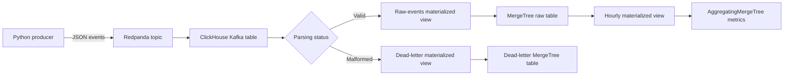

# Real-Time Flight Search Analytics with Redpanda and ClickHouse

An end-to-end streaming analytics project that generates synthetic
flight-search events, publishes them to a Kafka-compatible Redpanda topic,
ingests valid events through the ClickHouse Kafka table engine, quarantines
malformed messages, and incrementally builds hourly route metrics with
materialized views.

The project is intentionally small enough to run locally while demonstrating
the same ingestion, data-quality, analytical, and performance-testing patterns
used in larger data platforms.

## Architecture



## What the project demonstrates

- Kafka-compatible streaming with Redpanda
- Native ClickHouse ingestion using the Kafka table engine
- Durable raw-event storage using `MergeTree`
- Incremental hourly aggregation using `AggregatingMergeTree`
- Materialized views as the streaming transformation layer
- Data-quality routing for malformed events
- Dead-letter storage with Kafka topic, partition, offset, and parsing error
- Partitioning and ordering choices for time-series analytical data
- Reproducible synthetic data generation
- Reproducible performance experiments for sorting keys and skip indexes
- Bloom-filter evaluation for high-cardinality equality lookups
- Container health checks and dependency ordering
- Automated Python tests with GitHub Actions

All generated data is synthetic. The schema is inspired by common travel
analytics use cases and contains no company or customer data.

## Event model

Each event represents one flight search and includes:

- event and session identifiers
- event timestamp and synthetic user identifier
- origin, destination, and cabin class
- passenger counts
- number of available results and minimum displayed price
- response time, device, and acquisition source

The producer uses a fixed random seed by default, making the business-value
distribution reproducible across runs. Event IDs and timestamps remain unique.

## Quick start

### 1. Create the local environment file

Linux or macOS:

```bash
cp .env.example .env
```

PowerShell:

```powershell
Copy-Item .env.example .env
```

Change `CLICKHOUSE_PASSWORD` in `.env` before starting the stack.

### 2. Start the complete pipeline

```bash
docker compose up --build -d
```

The startup sequence is:

1. Redpanda becomes healthy.
2. `redpanda-init` creates the `flight_search_events` topic with three
   partitions.
3. ClickHouse creates the raw, aggregate, and dead-letter tables and their
   materialized views.
4. The Python producer begins publishing synthetic events.

### 3. Watch the producer

```bash
docker compose logs -f producer
```

### 4. Verify data in ClickHouse

Open the ClickHouse client:

```bash
docker exec -it realtime-clickhouse clickhouse-client \
  --user parisa \
  --password YOUR_PASSWORD
```

Then run:

```sql
SELECT
    count(),
    min(event_time),
    max(event_time)
FROM realtime.flight_search_events;
```

The full verification query set, including dead-letter inspection and
ingestion-health checks, is available in
[`clickhouse/queries/verification.sql`](clickhouse/queries/verification.sql).

### 5. Test malformed-event handling

Publish a deliberately invalid event from Git Bash, Linux, or macOS:

```bash
printf '%s\n' \
'{"event_time":"not-a-date","event_id":"not-a-uuid","origin":"THR","destination":"IST"}' \
| docker exec -i realtime-redpanda \
  rpk topic produce flight_search_events --brokers redpanda:9092
```

Inspect the captured message:

```sql
SELECT
    failed_at,
    topic,
    partition,
    offset,
    raw_message,
    error_message
FROM realtime.flight_search_dead_letters
ORDER BY failed_at DESC
LIMIT 5;
```

Malformed messages are excluded from the main raw table. Their payload,
parsing error, and Kafka metadata are retained for 30 days for investigation
or replay.

### 6. Open Redpanda Console

Redpanda Console is available at:

```text
http://localhost:8080
```

ClickHouse HTTP is available at `http://localhost:18123`, and the native
protocol is exposed on port `19001`.

## Performance benchmark highlights

Milestone 3 adds reproducible experiments over 1,000,000 deterministic
synthetic events. Each reported query was measured over ten executions after
warm-up.

| Experiment | Better design | Median duration | Read reduction |
|---|---|---:|---:|
| Route filter over a broad time range | Route-first sorting key | 8 ms vs 13 ms | 89.3% fewer rows |
| One-day filter across all routes | Time-first sorting key | 5 ms vs 7.5 ms | 92% fewer rows |
| Exact high-cardinality event-ID lookup | Bloom-filter index | 3 ms vs 25.5 ms | 99.18% fewer rows |

The Bloom-filter index increased table storage by approximately 4.2%, while
reducing median bytes read by approximately 99.1% for the tested exact-ID
lookup.

These measurements were produced in a local Docker environment using
synthetic data. They demonstrate design trade-offs and should not be treated
as universal performance claims.

The full methodology, SQL definitions, reproduction scripts, measured
resource usage, and limitations are documented in the
[ClickHouse benchmark report](clickhouse/benchmarks/README.md).

## Run the performance benchmarks

Create the comparison tables:

```bash
docker exec -i realtime-clickhouse sh -c \
'clickhouse-client --user "$CLICKHOUSE_USER" --password "$CLICKHOUSE_PASSWORD" --multiquery' \
< clickhouse/benchmarks/01_create_tables.sql
```

Load the deterministic dataset:

```bash
docker exec -i realtime-clickhouse sh -c \
'clickhouse-client --user "$CLICKHOUSE_USER" --password "$CLICKHOUSE_PASSWORD" --multiquery' \
< clickhouse/benchmarks/02_load_data.sql
```

Run the ordering-key benchmark:

```bash
bash clickhouse/benchmarks/run_ordering_key_benchmark.sh 10
```

Create the Bloom-filter comparison table:

```bash
docker exec -i realtime-clickhouse sh -c \
'clickhouse-client --user "$CLICKHOUSE_USER" --password "$CLICKHOUSE_PASSWORD" --multiquery' \
< clickhouse/benchmarks/03_create_bloom_table.sql
```

Run the Bloom-filter benchmark:

```bash
bash clickhouse/benchmarks/run_bloom_filter_benchmark.sh 10
```

## Useful commands

```bash
# Show service health and status
docker compose ps

# Follow ClickHouse and producer logs
docker compose logs -f clickhouse producer

# Stop containers but keep data volumes
docker compose down

# Remove containers and local volumes for a clean restart
docker compose down -v
```

## Repository structure

```text
.
├── .github
│   └── workflows
│       └── python-tests.yml
├── clickhouse
│   ├── benchmarks
│   │   ├── 01_create_tables.sql
│   │   ├── 02_load_data.sql
│   │   ├── 03_create_bloom_table.sql
│   │   ├── README.md
│   │   ├── run_bloom_filter_benchmark.sh
│   │   └── run_ordering_key_benchmark.sh
│   ├── init
│   │   ├── 01_pipeline.sql
│   │   └── 02_data_quality.sql
│   └── queries
│       └── verification.sql
├── producer
│   ├── Dockerfile
│   ├── producer.py
│   ├── requirements.txt
│   └── test_producer.py
├── .env.example
├── .gitignore
├── docker-compose.yml
├── LICENSE
└── README.md
```

## Design decisions

### Native Kafka ingestion

ClickHouse consumes directly from Redpanda through a Kafka-engine table. A
materialized view moves each consumed block into a durable `MergeTree` table,
avoiding a separate custom consumer for the database write path.

### Raw and aggregate layers

Raw events remain available for debugging and new analytical questions. A
second materialized view maintains hourly route aggregates so common
route-level metrics do not need to scan the entire raw table.

### Data quality and dead-letter handling

The Kafka table uses:

```sql
kafka_handle_error_mode = 'stream'
```

This exposes parsing failures through the `_raw_message` and `_error` virtual
columns.

One materialized view filters valid events into the main raw table, while
another routes malformed messages into a dedicated `MergeTree` dead-letter
table together with their topic, partition, offset, and Kafka timestamp.

This prevents malformed messages from stopping valid ingestion and preserves
enough context for diagnosis and replay.

### Partition and sort keys

The production-style raw table is partitioned monthly and ordered by route,
event time, and event ID. This supports route-oriented queries and time-range
pruning while retaining a unique tie-breaker for events sharing a timestamp.

The benchmark suite separately measures how route-first and time-first sorting
keys behave under different query patterns.

### Measured schema trade-offs

Sorting-key and skip-index choices are evaluated through deterministic,
repeatable experiments rather than treated as generic recommendations.

The benchmark scripts:

- generate identical comparison datasets
- perform warm-up executions
- alternate query execution order
- assign unique query IDs
- collect metrics from `system.query_log`
- report median duration, rows read, bytes read, and memory usage
- document storage overhead and experimental limitations

### Synthetic data only

The producer models realistic route, price, device, and response-time
distributions without using proprietary data. A fixed seed makes tests and
demonstrations repeatable.

## Current scope and milestones

### Milestone 1 — end-to-end streaming pipeline

- Redpanda topic initialization
- continuous synthetic event production
- Kafka Engine ingestion
- durable raw storage
- incremental hourly route metrics
- verification and ingestion-latency queries
- producer unit tests and CI

### Milestone 2 — data-quality handling

- valid and malformed event routing
- durable dead-letter storage
- Kafka metadata and parsing-error capture
- 30-day retention for malformed messages
- verification that valid ingestion continues after parsing failures

### Milestone 3 — reproducible performance experiments

- deterministic one-million-row benchmark dataset
- route-first versus time-first sorting-key comparison
- primary-index and granule-pruning analysis
- repeated query execution with median resource measurements
- Bloom-filter evaluation for exact high-cardinality lookups
- storage-overhead measurement
- documented methodology, results, and limitations

## Planned next

1. Document delivery semantics, duplicate scenarios, and recovery procedures.
2. Test container and consumer recovery after controlled failures.
3. Add idempotency and duplicate-detection experiments.
4. Add a lightweight dashboard for route, price, and ingestion-health metrics.

## License

MIT